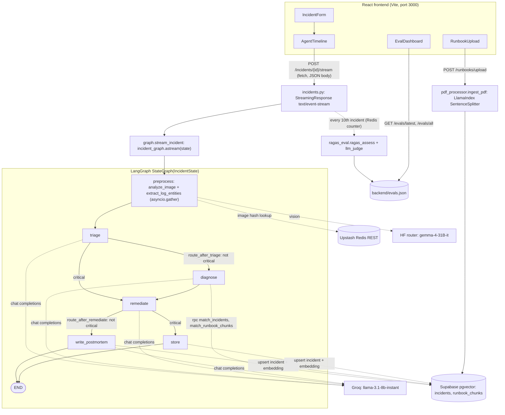

# SynthSense

Incident analysis for on-call engineers: paste logs or attach a dashboard screenshot, and a LangGraph pipeline triages, diagnoses, plans remediation and writes a postmortem, streaming each step to the browser.

[](https://python.org)
[](https://fastapi.tiangolo.com)
[](https://react.dev)
[](https://langchain-ai.github.io/langgraph/)
[](LICENSE)

## Demo

No live demo yet.

<!-- SCREENSHOT: Agent timeline page mid-run, showing triage and diagnosis completed and remediation in progress. Save as docs/screenshot.png -->

## What it does

- **Multimodal input.** Raw logs or a free-text description, plus an optional screenshot. Log entities are extracted with Groq (JSON mode). Images go to a vision model (default `google/gemma-4-31B-it`) through the Hugging Face router, and successful results are cached in Upstash Redis by image hash for 24 hours.
- **Triage.** Severity classification (`critical`, `high`, `medium`, `low`) with a confidence score in a single Groq call.
- **Diagnosis with retrieval.** Embeds the incident locally with `BAAI/bge-small-en` and queries past incidents and runbook chunks in Supabase pgvector in parallel, then asks Groq for a root cause.
- **Remediation plan.** Structured JSON: immediate steps, investigation steps, escalation threshold, estimated resolution time, runbook references.
- **Postmortem and memory.** Writes a blameless postmortem, embeds it, and stores the incident so later diagnoses can retrieve it.
- **Critical fast path.** `critical` incidents skip diagnosis and the postmortem and go straight from remediation to storage.
- **Live progress.** Each graph node's output is sent to the browser as a Server-Sent Event as soon as that node finishes.
- **Runbook ingestion.** Upload a PDF (up to 20 MB). It is split into 512-token chunks with LlamaIndex, embedded and stored. Re-uploading the same filename is skipped.
- **Quality checks.** Every 10th incident starts a background RAGAS run (faithfulness, answer relevancy, context recall) plus an LLM judge over a sample of synthetic incidents. Results are appended to `evals.json` and charted on the Evals page.

## Architecture



Design notes:

- The pipeline is a LangGraph `StateGraph` over a `TypedDict` state (`IncidentState` in `backend/agents/graph.py`). Each node returns only the keys it changes, and two conditional edges implement the critical fast path. The tradeoff is that a critical incident is stored without a diagnosis or postmortem.
- Streaming is per node, not per token: `stream_incident` iterates `incident_graph.astream()` and wraps each node's update as an SSE event. Users see progress at node boundaries, and the server stays simple.
- The frontend reads the stream with `fetch` and a `ReadableStream` instead of `EventSource`, because `EventSource` only supports GET and a base64 screenshot would not fit in a URL. A GET stream endpoint is kept for curl.
- Vectors and incident records live in one Supabase Postgres database (pgvector), with similarity search done by two SQL functions called over RPC. Embeddings are computed locally with sentence-transformers (384 dimensions), so retrieval needs no embedding API.
- Calls to Groq, Hugging Face, Supabase and Upstash go through `tenacity` retries with exponential backoff, because free-tier models can cold-start and rate-limit. If image analysis still fails, the pipeline continues with a fallback description.
- LangSmith tracing is switched on through `LANGCHAIN_*` environment variables, and context retrieval is marked with `@traceable`.

## Stack

| Layer | In this repo |
|---|---|
| Orchestration | LangGraph 0.1.19 |
| LLM | Groq SDK, model `llama-3.1-8b-instant` (configurable) |
| Vision | Hugging Face router (`router.huggingface.co`), `google/gemma-4-31B-it` |
| Embeddings | sentence-transformers 2.7, `BAAI/bge-small-en` (local) |
| Document parsing | LlamaIndex core (PDF reader, sentence splitter), pypdf |
| Storage | Supabase (Postgres + pgvector) |
| Cache and counters | Upstash Redis over REST (httpx) |
| Evaluation | RAGAS 0.1.21, datasets, LLM judge via Groq |
| Tracing | LangSmith |
| Backend | FastAPI 0.111, Uvicorn, Pydantic Settings, structlog, tenacity |
| Frontend | React 18, React Router, Vite 5, Tailwind CSS, Recharts, axios |
| Packaging | Docker, Docker Compose |

## Run it locally

You need accounts and keys for five services. All variables are listed in `.env.example` and loaded by `backend/config.py`.

| Variable | Service |
|---|---|
| `GROQ_API_KEY` | [Groq](https://console.groq.com) |
| `HUGGINGFACE_API_KEY` | [Hugging Face](https://huggingface.co/settings/tokens) access token |
| `SUPABASE_URL`, `SUPABASE_KEY` | [Supabase](https://supabase.com) project URL and `service_role` key |
| `UPSTASH_REDIS_REST_URL`, `UPSTASH_REDIS_REST_TOKEN` | [Upstash](https://upstash.com) Redis REST API |
| `LANGCHAIN_API_KEY` | [LangSmith](https://smith.langchain.com) |

Optional: `GROQ_MODEL`, `HF_VISION_MODEL`, `LOG_LEVEL`, `EVAL_EVERY_N_INCIDENTS`.

**1. Configure**

```bash
git clone https://github.com/waterma1one/synthsense.git
cd synthsense
cp .env.example .env   # then fill in the keys above
```

**2. Create the database objects.** Open the Supabase SQL editor and run the SQL block in the module docstring at the top of `backend/memory/vector_store.py`. It enables `vector`, creates the `incidents` and `runbook_chunks` tables with ivfflat indexes, and defines the `match_incidents` and `match_runbook_chunks` functions that the diagnosis step calls.

**3a. Run with Docker Compose**

```bash
docker compose up --build
```

Frontend at http://localhost:3000, API at http://localhost:8000, Swagger UI at http://localhost:8000/docs.

**3b. Or run without Docker** (Python 3.11, matching the backend Dockerfile, and Node 20)

```bash
# Terminal 1: backend
cd backend
python -m venv venv && source venv/bin/activate
pip install -r requirements.txt
uvicorn main:app --reload --port 8000

# Terminal 2: frontend
cd frontend
npm install
npm run dev
```

Vite serves on http://localhost:3000 (set in `frontend/vite.config.js`), which is one of the origins allowed by the backend's CORS settings. The frontend calls `http://localhost:8000` unless `VITE_API_URL` is set.

## API

| Method | Path | Purpose |
|---|---|---|
| `POST` | `/incidents` | Run the whole pipeline and return the final state (form fields `description`, optional `image`) |
| `POST` | `/incidents/{id}/stream` | SSE stream of node updates, JSON body `{description, image_b64}` (used by the UI) |
| `GET` | `/incidents/{id}/stream` | Same stream, query parameters, for curl |
| `GET` | `/incidents/{id}` | Stored incident record |
| `GET` | `/incidents?limit=20` | Recent incidents (max 100) |
| `POST` | `/runbooks/upload` | Ingest a runbook PDF |
| `GET` | `/evals/latest`, `/evals/all` | Latest and historical evaluation records |
| `GET` | `/health` | Liveness check |

Example:

```bash
curl -X POST http://localhost:8000/incidents \
  -F "description=2024-01-15T14:23:01Z ERROR api-gateway Connection refused to payment-service:8080
2024-01-15T14:23:05Z CRIT  payment-service Pod CrashLoopBackOff: exit code 137 (OOM)"

curl -N "http://localhost:8000/incidents/$(uuidgen)/stream?description=payment-service+OOMKilled"
```

Each stream event has the shape `{"incident_id": ..., "agent": "<node name>", "status": "completed", "output": {...}}`. The last event has `"agent": "done"`, and a failure produces `"agent": "error"`.

## Tests and evaluation

There is no unit test suite in the repository.

Evaluation runs from the `backend` directory and needs the same keys as the app:

```bash
cd backend
python -m eval.synthetic_data generate   # 20 synthetic incidents (5 categories x 4) via Groq
python -m eval.ragas_eval run            # diagnosis on 5 of them, scored with RAGAS + LLM judge
```

`ragas_eval run` prints a JSON record with `timestamp`, `sample_size` and `scores` (`faithfulness`, `answer_relevancy`, `context_recall`, and a `judge` block with `accuracy`, `completeness`, `actionability`, `specificity`, `overall`), and appends it to `backend/evals.json`. No evaluation results are committed to the repository, so this README does not quote scores.

## Project layout

```
backend/
  agents/      LangGraph graph (graph.py) and the triage, diagnosis, remediation, postmortem nodes
  api/         FastAPI routers: incidents (incl. SSE), runbooks, evals
  eval/        RAGAS run, LLM judge, synthetic incident generator
  ingestion/   Image analysis (vision model), log entity extraction, PDF chunking
  memory/      Supabase pgvector access (includes setup SQL) and Upstash Redis client
  config.py    Pydantic Settings for all environment variables
  main.py      FastAPI app, CORS, request logging, router wiring
frontend/
  src/api/         axios client and fetch-based SSE reader
  src/components/  Incident form, agent timeline, remediation checklist, history, runbook upload, eval dashboard
docker-compose.yml
.env.example
```

## Limitations and next steps

- No authentication. Anyone who can reach the API can read and write incident data.
- Background evaluation runs as `asyncio` tasks inside the web process. A durable job queue would survive restarts and retry failures.
- Evaluation scores the diagnosis step on synthetic incidents, not on the incidents users submit. `POST /incidents` also runs the LLM judge on the real incident, but only logs the score.
- The image path was moved from the retired HF Inference API (LLaVA) to the HF router. It is covered by mocked-HTTP tests only; I have not run it against a live token, and router providers for a given model can change. Set `HF_VISION_MODEL` to another vision-capable model if this one stops being served.
- The models were chosen for free-tier access. A larger LLM and vision model would likely improve JSON reliability and screenshot interpretation.
- Results go to `evals.json` on local disk, so they are not shared across instances.

## License

MIT. See [LICENSE](LICENSE).
